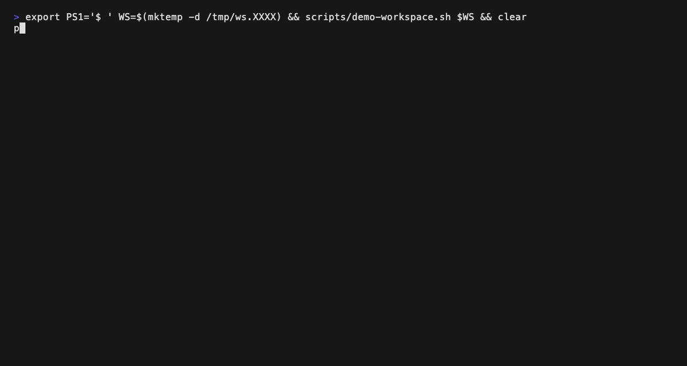

<!-- SPDX-FileCopyrightText: 2026 Sebastien Rousseau <sebastian.rousseau@gmail.com> -->
<!-- SPDX-License-Identifier: MIT OR Apache-2.0 -->

<p align="center">
  
</p>

<h1 align="center">code-portfolio-compliance</h1>

<p align="center">
  Audits every git repository in a <code>~/Code</code> workspace against the 24-signal compliance matrix of <code>~/Code/AGENTS.md</code> and writes JSON, CSV and Markdown reports.
</p>

<p align="center">
  <a href="https://github.com/sebastienrousseau/code-portfolio-compliance/actions/workflows/ci.yml"></a>
  <a href="https://github.com/sebastienrousseau/code-portfolio-compliance/releases"></a>
  <a href="#documentation"></a>
  <a href="https://scorecard.dev/viewer/?uri=github.com/sebastienrousseau/code-portfolio-compliance"></a>
  <a href="LICENSE-MIT"></a>
  <a href="docs/POLICIES.md"></a>
</p>

<p align="center">
  
</p>

---

## Contents

**Getting started**

- [Install](#install) — clone and run with Python, or install the command with uv
- [Requirements](#requirements) — Python 3.12+, git; uv and Node for development
- [Quick Start](#quick-start) — audit the workspace and read the reports

**The code-portfolio-compliance ecosystem**

- [The code-portfolio-compliance ecosystem](#the-code-portfolio-compliance-ecosystem) — the audit, the report writer, the gates

**Library reference**

- [Capabilities at a glance](#capabilities-at-a-glance) — the eight categories and three tiers
- [Ecosystem comparison](#ecosystem-comparison) — why there is nothing to compare against
- [Benchmarks](#benchmarks) — one full-workspace run
- [Features](#features) — what each signal looks for
- [Configuration](#configuration) — command-line options and `.compliance.yml`
- [Examples](#examples) — the demo workspace

**Operational**

- [When not to use code-portfolio-compliance](#when-not-to-use-code-portfolio-compliance) — limitations
- [Development](#development) — make targets and CI
- [Security](#security) — what the tool reads and runs
- [Documentation](#documentation) — all reference docs
- [Stability guarantees](#stability-guarantees) — versions and report schema
- [License](#license)

---

## Install

The tool is a single script with no dependencies beyond the Python standard
library. Clone it into the workspace it audits:

```bash
git clone https://github.com/sebastienrousseau/code-portfolio-compliance.git ~/Code/Private/Other/code-portfolio-compliance
```

To get an `audit-compliance` command on your path instead:

```bash
uv tool install ~/Code/Private/Other/code-portfolio-compliance
```

The installed command cannot find the workspace from its install location,
so pass `--root ~/Code --output <dir>`. The repository is private and not
published to PyPI.

---

## Requirements

- **Python 3.12 or later.** CI tests 3.12 and 3.13.
- **git**, on the path. The audit reads `git status` and `git tag` in each
  repository.
- **A workspace** whose root holds `Forks/`, `Private/`, `Public/` and
  `Work/`, or an explicit `--root`.
- For development only: [uv](https://docs.astral.sh/uv/), Node (for
  markdownlint-cli2), shellcheck, and [VHS](https://github.com/charmbracelet/vhs)
  to re-render the demo.

---

## Quick Start

```bash
cd ~/Code/Private/Other/code-portfolio-compliance
python3 tools/audit_compliance.py
open reports/README.md
```

With no options the tool walks up from its own location to the workspace
root, audits every git repository under `Public/`, `Private/`, `Work/` and
`Forks/`, and writes four files to `reports/`: `README.md` (summary and
heat map), `audit.json` (every check and its evidence), `audit.csv` (triage
table) and `rewrite-queue.txt` (repositories whose README can be safely
rewritten to the template).

---

## The code-portfolio-compliance ecosystem

Everything lives in this repository.

| Component | Purpose | Use case |
| :--- | :--- | :--- |
| [`tools/audit_compliance.py`](tools/audit_compliance.py) | Discovers repositories, reads declarations and the README template, runs the command line | Portfolio audit (`~/Code/AGENTS.md` §8) |
| [`tools/compliance_checks.py`](tools/compliance_checks.py) | Evaluates the 24 signals: evidence, not-applicable reasons, one function per category | Called by the audit |
| [`tools/compliance_report.py`](tools/compliance_report.py) | Writes the JSON, CSV, rewrite queue and Markdown reports | Called by the audit |
| [`scripts/complexity_gate.py`](scripts/complexity_gate.py) | Enforces the per-function complexity ceilings against `complexity-baseline.json` | `make complexity`, CI |
| [`scripts/readme_check.py`](scripts/readme_check.py) | Runs the audit's own README template check on this README | `make readme-check`, CI |
| [`scripts/demo-workspace.sh`](scripts/demo-workspace.sh) | Builds a throwaway three-repository workspace | `make demo` |

---

## Capabilities at a glance

The matrix has eight categories, each with a signal at three tiers, so 24
signals per repository.

| Area | Capability | Status |
| :--- | :--- | :--- |
| C1 Identity & README | README sections, licence, README CI, install-snippet CI | Checked |
| C2 Documentation | README and source surface, docs root, ADRs, migration guides | Checked |
| C3 Build & Install UX | Build manifest, Makefile, completions, manpages | Checked |
| C4 Releases & Binaries | Tags and changelog, release workflow, signing, SLSA, SBOM | Checked |
| C5 Packaging | Registry packaging, containers, reproducibility | Checked |
| C6 CI Quality Gates | Lint, format and tests in CI, coverage, fuzzing | Checked |
| C7 Supply Chain | `SECURITY.md`, dependency scanning, lockfile, advisories, Scorecard | Checked |
| C8 Community | Code of conduct, contributing guide, templates, `AGENTS.md` | Checked |
| Tiers | Candidate tier: the highest level whose signals all pass | Computed |
| README template | Heading order, unresolved `{{TOKENS}}`, required structure | Checked |

---

## Ecosystem comparison

This tool checks a matrix defined only in `~/Code/AGENTS.md` and
`~/Code/REPO-STANDARD.md`, so there is no other implementation to compare it
with. General repository-health tools score different criteria.

| Project | Checks this matrix | Reads local clones | Writes portfolio reports |
| :--- | :---: | :---: | :---: |
| **code-portfolio-compliance** | Yes | Yes | Yes |

See [`docs/COMPARISON.md`](docs/COMPARISON.md) for the evidence and complete matrix.

---

## Benchmarks

One measured run, not a benchmark suite: a full audit of the author's
workspace.

| Scenario | Result | Environment |
| :--- | ---: | :--- |
| Full workspace audit, 435 repositories | 4 min 12 s wall clock | macOS 26, Apple silicon, Python 3.12.15 |

See [`docs/BENCHMARKS.md`](docs/BENCHMARKS.md) for methodology and full results.

---

## Features

- **Static and conservative.** Every signal is a file, directory or text
  match in the repository and its workflows. A match records that something
  is present; it is not proof that CI passed. The reports say so.
- **Not applicable is not a pass.** A check whose subject does not exist
  (completions for a library, a lockfile for a module with no dependencies)
  is reported as `n/a` with its reason, satisfies its tier, and is left out
  of the score.
- **Declared tiers.** A repository's target tier, criticality and owner come
  from its `.compliance.yml`; see [Configuration](#configuration).
- **README template check.** The primary README must have the template's 17
  headings in order, no unresolved `{{TOKENS}}` outside code, and the
  centred header and badge structure.
- **A GitHub profile is not a project.** A repository whose origin is
  `<account>/<account>` and whose `.compliance.yml` declares that account as
  `owner` is a GitHub profile: its README is the rendered profile. The
  template check reports `n/a`, C1.L1 asks only for the README and a
  licence, C1.L2 for README-enforcing CI and `SECURITY.md`, and C1.L3 is
  `n/a`. Without the declared owner, an organisation's main repository
  named like the organisation would be mistaken for one.
- **No package, no API.** A `pyproject.toml` that sets
  `[tool.uv] package = false` builds nothing importable, so the API
  documentation and breakage checks are `n/a`.
- **Safe rewrite queue.** A repository is queued for a README rewrite only
  when its working tree is clean and it is not embedded in another
  repository, a fork or vendored code. A profile is never queued.

---

## Configuration

Command-line options:

| Option | Default | Meaning |
| :--- | :--- | :--- |
| `--root PATH` | Nearest parent of the script holding `Forks/`, `Private/`, `Public/` and `Work/` | Workspace to audit |
| `--roots NAME…` | `Public Private Work Forks` | Directories under the root to search for repositories |
| `--output PATH` | `reports/` next to `tools/` | Where the four reports are written |

A repository declares its target in `.compliance.yml`:

```yaml
tier: L1             # L1, L2 or L3
criticality: incubator  # incubator, standard, core
owner: sebastienrousseau
```

Without one, repositories under `Private/` and `Forks/` target L1, the rest
L2, and criticality is `unclassified`.

---

## Examples

The demo above is rendered from [`.github/demo.tape`](.github/demo.tape). To
run the same audit yourself:

```bash
WS=$(mktemp -d)
scripts/demo-workspace.sh "$WS"
python3 tools/audit_compliance.py --root "$WS" --output "$WS/reports"
cat "$WS/reports/README.md"
```

---

## When not to use code-portfolio-compliance

- **As proof of compliance.** It finds files and text, not passing CI runs.
  A signal that passes still needs the workflow to be seen green.
- **Outside this workspace layout.** It discovers repositories by `.git`
  under the four portfolio directories, and its matrix is this portfolio's.
- **On repositories you have not cloned.** It reads local working trees and
  never calls the GitHub API.

---

## Development

```bash
make help    # list the targets
make check   # lint, complexity, advisories, tests, package build
make demo    # re-render .github/demo.gif (needs vhs)
make audit   # audit the workspace into reports/
```

`make check` runs everything CI runs: ruff check and format, shellcheck,
markdownlint, this README against the template, the complexity ratchet,
pip-audit of the locked dev tools, pytest, and `uv build`. Functions must
stay within cyclomatic 10, cognitive 15, Halstead difficulty 30 and 60
lines, and files within 500 lines. Every function is within every ceiling,
so `complexity-baseline.json` is empty; the gate fails on any new
offender.

---

## Security

The audit only reads: it opens files in each repository and runs
`git status --porcelain` and `git tag -l` there with a timeout. It makes no
network calls and writes only to the output directory. CI runs Gitleaks on
the full history, Dependabot watches the pinned Actions and `uv.lock`, and
every workflow runs with read-only permissions.

Report vulnerabilities according to [`SECURITY.md`](SECURITY.md).

---

## Documentation

- [`docs/POLICIES.md`](docs/POLICIES.md): versioning, supported Python, report schema.
- [`docs/COMPARISON.md`](docs/COMPARISON.md): why no comparison table exists.
- [`docs/BENCHMARKS.md`](docs/BENCHMARKS.md): how the one timing was taken.
- [`CHANGELOG.md`](CHANGELOG.md): every change by release.
- [`CONTRIBUTING.md`](CONTRIBUTING.md), [`AGENTS.md`](AGENTS.md): how to change the tool.
- [`~/Code/AGENTS.md`](https://github.com/sebastienrousseau/standards/blob/main/AGENTS.md): the matrix this tool checks.

---

## Stability guarantees

Versions move by 0.0.1 a release (`v0.0.1`, `v0.0.2`, …). What other tools
depend on is the report format, so:

- **`audit.json`** carries `schema_version` (currently 2). Removing or
  renaming a field, or changing a value's type, raises it and is listed as
  breaking in the CHANGELOG.
- **A signal that changes what it accepts** is listed under **Changed**,
  with the repositories it moved when the change was made.
- **Command-line options** are only added; removing one is breaking.

---

## License

Dual-licensed under either of [MIT](LICENSE-MIT) or
[Apache-2.0](LICENSE-APACHE), at your option.
